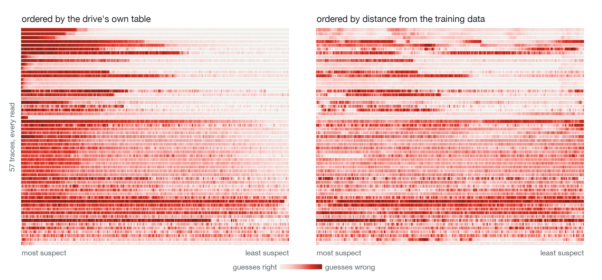
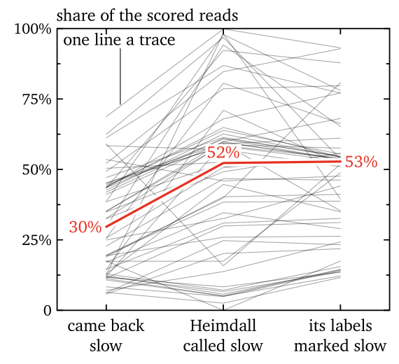
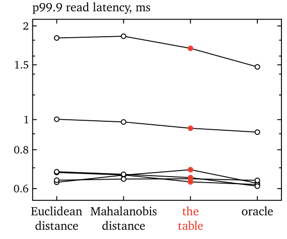

# Predicting, Fast and Slow: SSD Already Knows Which Guess Is Wrong

<picture>
  <source media="(prefers-color-scheme: dark)" srcset="figures/hero-strips-dark.png">
  
</picture>

**[Heimdall](https://doi.org/10.1145/3689031.3717496), a learned controller, calls slow on 52% of an SSD's reads when 30% are slow. Uncertainty estimators, [the remedy prescribed](https://proceedings.mlsys.org/paper_files/paper/2026/hash/96aca14d6c4dcd3adf54bc2c5ad7f138-Abstract-Conference.html) for its wrong guesses, cannot find them: nine of them do no better than a coin. The drive can.**

Above, every read of 57 held-out traces, one row a trace, red where Heimdall guessed wrong. A 4,096-entry table of how the drive's recent reads came back, untrained and 21 ns a decision, puts the wrong guesses first: a median AUROC of 0.68, where the nine sit at 0.46 to 0.52. And it predicts slow reads better than Heimdall itself.

**[The paper](paper/main.pdf)** is three pages. This repository is its supplement: the code, every result file, and one script that recomputes every number.

## Why doubt cannot find them

<picture>
  <source media="(prefers-color-scheme: dark)" srcset="figures/plates/bias-dark.svg">
  
</picture>

Heimdall is not unsure. It is tilted. Each thin line is one held-out trace, through how often its reads came back slow, how often Heimdall called slow, and how often its training labels marked slow. Red, the medians: 30%, 52% and 53%. The calls follow the labels, not the reads, and an estimator that asks how unfamiliar an input is cannot see that.

## The table

<picture>
  <source media="(prefers-color-scheme: dark)" srcset="figures/plates/table-dark.svg">
  
</picture>

One number per situation: how often reads submitted like this one have lately come back slow. Hatched, each cell's number after one held-out trace. Red, two of them: of the reads of 4 to 8 KiB that found less than 4 KiB outstanding, 2% came back slow, and Heimdall called 96% of them slow.

```python
# a read is submitted
cell = (size_class, outstanding_bytes_class, oldest_age_class, quiet_bit)
q = table[cell]                                  # how often reads like this one came back slow

# the read completes
table[cell] += ((latency > T) - table[cell]) / 64
```

T is the knee of the first minute's read latencies, so the table needs no training and no label but each read's own latency. A fast guess is suspect in proportion to q, a slow guess to 1 - q. The reference implementation, used unchanged for every result, is the 143 lines of [admission/tracker.py](admission/tracker.py).

## The tail cannot referee

<picture>
  <source media="(prefers-color-scheme: dark)" srcset="figures/plates/tail-dark.svg">
  
</picture>

The evidence offered for the estimators was tail latency. On two identical NVMe drives, with hedging on, it does not matter who picks the reads to distrust. Each line is one trace pair, and at the median round the better distance ends within 9% of the table (red) on every pair. An oracle told which guesses were wrong gains at most 13%.

How each number was made, and what the paper has no room for: [METHOD.md](METHOD.md).

## Check every number

```sh
python check.py
```

Python 3.10 or later, nothing to install, a few seconds. It recomputes every number in the paper, and every measurement the paper leaves out, from the per-trace result files in [results/](results/), and fails if one has drifted.

## Your own traces

A per-I/O latency log of four columns is all the pipeline needs: [METHOD.md](METHOD.md#run-it).

## What is where

| where | what |
|---|---|
| [METHOD.md](METHOD.md) | how each number was made, and what the paper has no room for |
| [results/](results/) | the result files, per trace and per drive run, and [all of them as tables](results/tables.md) |
| [admission/](admission/) | the table, Heimdall's pipeline reimplemented, the nine estimators, the simulator |
| [scripts/](scripts/) | the analyses that wrote the result files, and [summary.py](scripts/summary.py), which every number comes from |
| [bench/](bench/) | the replayer, the quiet-machine recorder and the cost benchmark, in C |
| [paper/](paper/), [figures/](figures/), [tests/](tests/) | the paper's source, the script behind each figure, the table on cases worked by hand |

## Cite

```bibtex
@misc{bogdan2026predicting,
  author = {Philipp Bogdan},
  title  = {Predicting, Fast and Slow: {SSD} Already Knows Which Guess Is Wrong},
  year   = {2026}
}
```

Our code, results, figures and text are released under [CC0 1.0](LICENSE). What belongs to others is in [NOTICE.md](NOTICE.md).
